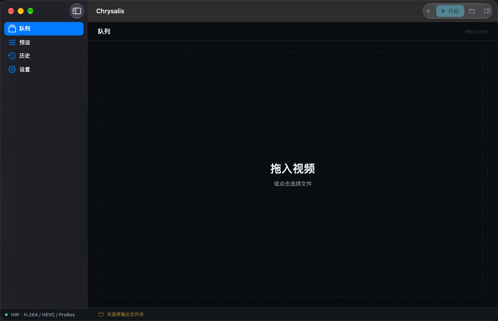
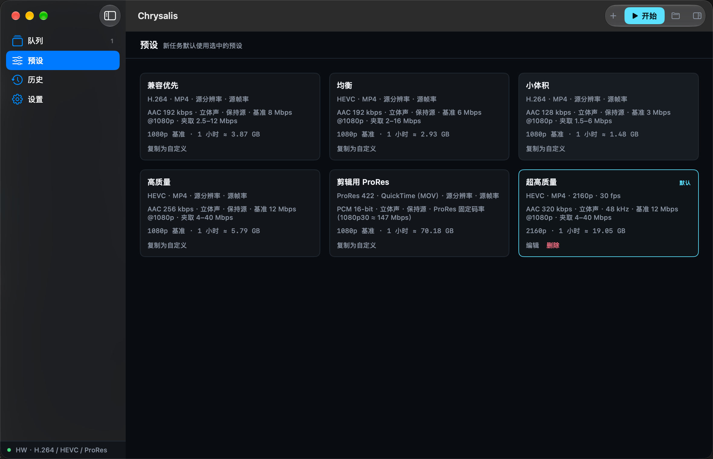
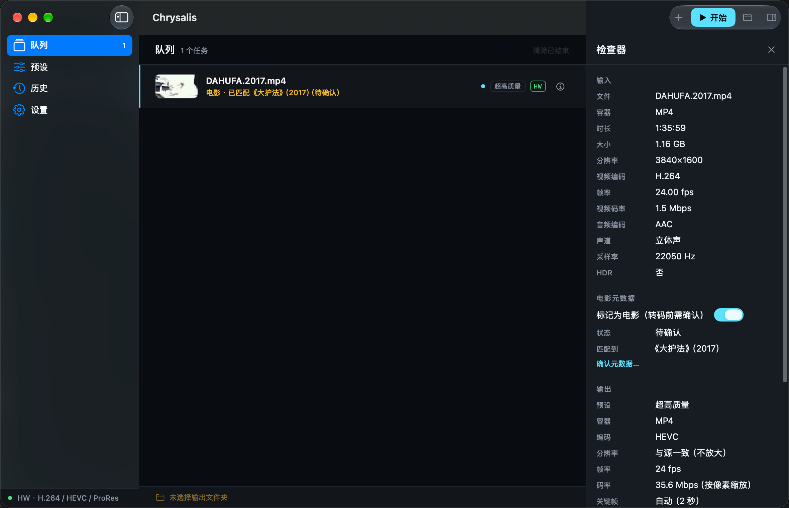
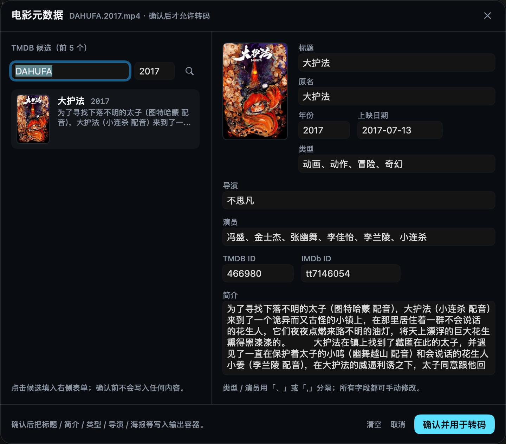

# Chrysalis 蝉蜕

**[简体中文](README.md) | English**

A local video transcoder for macOS: drop in videos and batch-convert them to H.264 / HEVC / ProRes on the Apple hardware media engine (VideoToolbox) — speed first, low CPU usage. Optionally fetch movie metadata from TMDB and, after your confirmation, write it into the MP4/MOV container. Pure Swift + SwiftUI with zero third-party dependencies.

> The Chinese name 「蝉蜕」 means "cicada slough" — transcoding as metamorphosis: the old shell (container) is left behind while the essence of the image flies on, intact. The English name "Chrysalis" is the pupal casing — the silent vessel where transformation happens. Original files are preserved and output is written atomically, true to the name.

## Highlights

- **Fast and efficient**: VideoToolbox hardware encoding is mandatory by default. Measured on M1 Pro: 1080p H.264 → H.264 at **6.2x** and 4K HEVC → 1080p H.264 at **5.7x**. If no hardware encoder is available the task fails explicitly — **never a silent fallback to software**.
- **Pure Apple stack, zero third-party dependencies**: Swift 6 (strict concurrency) + SwiftUI + AVFoundation. No FFmpeg / libav.
- **Local-first, safe writes**: everything runs on your machine — nothing is uploaded (only TMDB is contacted, and only for movie metadata). Output is written atomically, so a failure or cancellation never leaves a half-finished file. App Sandbox + security-scoped bookmarks.
- **Batch queue**: serial execution across many files, per-task cancel/retry, clear finished tasks in one click; thumbnails, live progress, speed and ETA. The queue survives relaunches — interrupted tasks can be retried.
- **5 built-in presets + visual editor**: Compatibility / Balanced / Small Size / High Quality / ProRes for Editing. Custom resolution, frame rate, container, audio, with live size estimation.
- **Fine-grained bitrate control**: average bitrate / quality-based / target size (MB); keyframe interval, H.264 profile, the full ProRes 422 family + PCM 16/24-bit audio.
- **Movie metadata (optional TMDB)**: automatic matching of title/year/director/poster → **transcoding only starts after your confirmation** (never written silently). Metadata and poster are written into the MP4/MOV container, visible via Finder's "Show Info". Local proxy supported.
- **History**: every finished task is recorded (up to 500). Reveal output in Finder, re-transcode in one click, edit metadata. System notifications on completion/failure (optional).
- **Restrained, minimal UI**: dark-first, single accent color, monospaced numerals; full Reduce Motion support; localized in Chinese.

## Screenshots

<p align="center">
  
  
  
  
</p>

## Requirements

- macOS 27.0 or later
- An Apple hardware encoder (Apple Silicon, or a Mac with an Apple T2 or newer media engine). The app probes hardware at launch and shows a capability matrix in the UI.

## Build from Source

```bash
git clone git@github.com:Darkiiiiiice/Chrysalis.git
open Chrysalis/Chrysalis.xcodeproj
# Run with ⌘R in Xcode; or from the command line:
xcodebuild -project Chrysalis/Chrysalis.xcodeproj -scheme Chrysalis -configuration Debug build
```

## Usage

### Basics

1. **Add files**: drag MP4 / MOV / M4V videos into the window, press `⌘O`, or click the drop zone (unsupported types are filtered with a notice).
2. **Pick a preset** in the add panel, or set a default on the Presets page so every new task uses it.
3. **Choose an output folder** from the status bar or `⇧⌘O`. Name collisions get a `-1` suffix — existing files are never overwritten.
4. **Start** with the Start button or `⌘↩`. Tasks run serially with live progress, speed and ETA. Cancel any task individually (`⌘.` cancels all).
5. **Retry**: cancelled/failed/interrupted tasks show a ↻ button; finished tasks can be removed via the trash button or context menu, or cleared all at once.

### Movie Metadata (optional)

1. In Settings, paste a TMDB API key (v3) or Read Access Token (v4) → "Verify & Save". Credentials are stored only in the Keychain. Mainland China users can configure a local proxy under "Network Proxy" (e.g. Clash's default `127.0.0.1:7890`) and use "Test Connection".
2. Enable "These are movies" when adding files (or toggle "Mark as movie" per task in the inspector).
3. The app parses the filename and searches TMDB automatically; the queue row shows the match directly (e.g. `Movie · Matched <Title> (2017) (pending confirmation)`).
4. Click "Confirm metadata…" to open the confirmation sheet: candidate list (poster/title/year/overview) on the left, an editable form on the right. Fully offline manual entry works too.
5. **Tasks cannot start until metadata is confirmed** — automatic matches are never written silently. Once confirmed, title/director/overview/poster are embedded in the output container (iTunes atoms for MP4, QuickTime keys for MOV), visible in Finder's "Show Info".

### Presets

- 5 read-only built-ins: Compatibility (H.264), Balanced (HEVC), Small Size (H.264), High Quality (HEVC), ProRes for Editing (ProRes 422 + MOV + PCM). "Duplicate" any of them to create your own (like the 4K HEVC "Ultra High Quality" preset in the screenshot).
- Custom presets can change: resolution (source / 2160p–480p, downscale only), frame rate (downgrade only), container (MP4 / MOV), audio (up to 320 kbps, sample rate, mono/stereo), bitrate mode (average / quality-based / target size), keyframe interval and H.264 profile — with a live size estimate in the editor.

### History & Output

- Every task that reaches a final state is recorded in History (up to 500 entries). Right-click to reveal the output in Finder, **re-transcode** (reusing the original preset and metadata), edit metadata, or delete the entry.
- Completion / failure triggers a system notification (toggle in Settings → Notifications; cancellations and interruptions stay silent).
- Quit mid-transcode and reopen: the queue is restored, in-flight tasks are marked "Interrupted" and can be retried in one click.

### Keyboard Shortcuts

| Shortcut | Action |
|---|---|
| `⌘O` | Add files |
| `⇧⌘O` | Choose output folder |
| `⌘↩` | Start all |
| `⌘.` | Cancel all |
| `⌘I` | Toggle inspector |

## Supported Formats (v1)

| | |
|---|---|
| Input | MP4, MOV, M4V |
| Output | H.264, HEVC (MP4 / MOV), ProRes 422 family (MOV) |
| Resolution | Keep source, or scale down to 2160p / 1440p / 1080p / 720p / 480p (never upscaled) |
| Not supported | MKV / AVI / WebM inputs; AV1 / VP9 encoding; HDR sources (detected and rejected); subtitle burning, multiple audio tracks, trimming |

## Under the Hood

- Pure Swift 6 + SwiftUI + system frameworks (AVFoundation / VideoToolbox / CoreMedia / CoreImage) — **zero third-party dependencies**.
- Built on the modern macOS 27 AVFoundation async model: `AVAssetReader` demux/decode + VideoToolbox hardware encoding + `AVAssetWriter` muxing; rotation/scaling via `AVVideoComposition`.
- Movie metadata touches the network only when "movie" is enabled (TMDB). Credentials live in the Keychain; search/details/poster responses are cached locally for 7 days; requests are serialized and rate-limited, with human-readable errors for 401 / 429 / timeouts.
- App Sandbox + Hardened Runtime; all file access via security-scoped bookmarks; queue, history and presets are local JSON files. Your source videos are never modified.

---

This product uses the TMDB API but is not endorsed or certified by TMDB.
