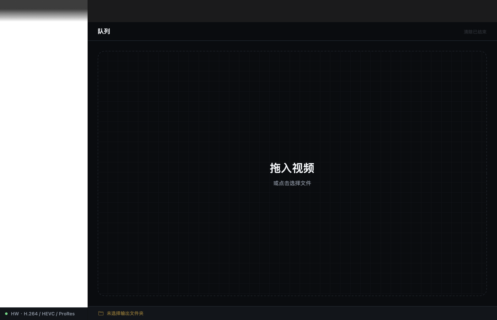
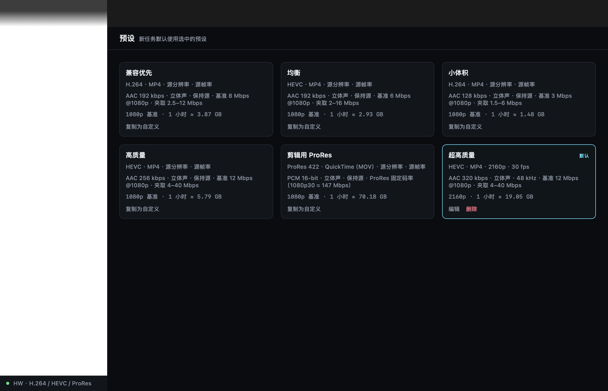
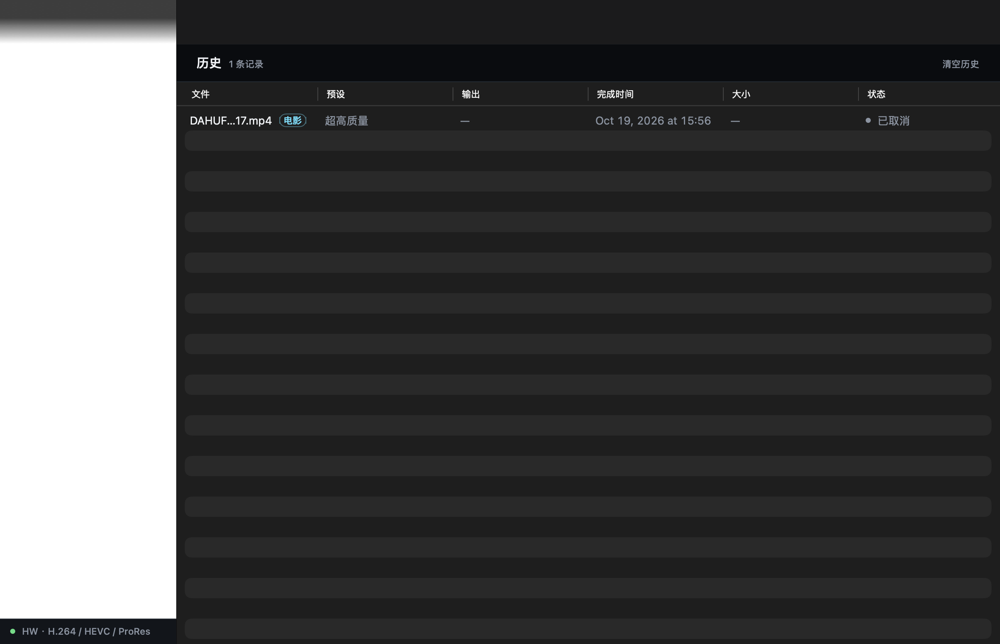
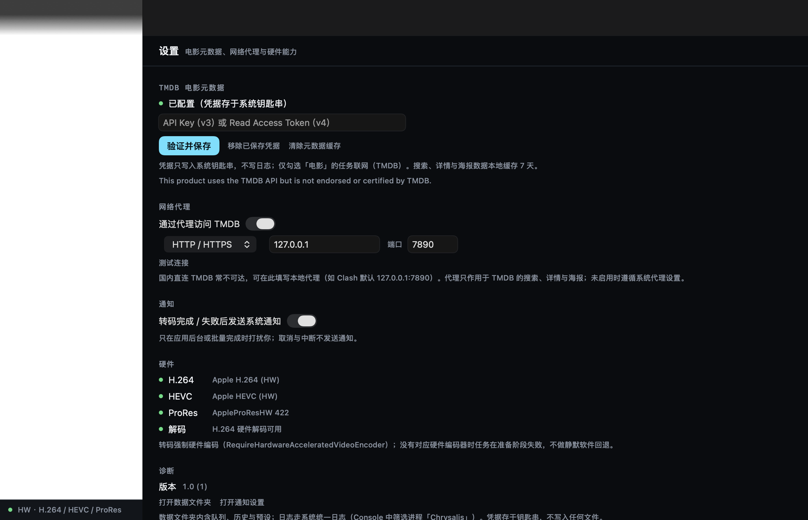

# 蝉蜕（Chrysalis）

macOS 上的本地视频转码工具：拖入视频，批量转码为 H.264 / HEVC / ProRes，默认走 Apple 硬件媒体引擎（VideoToolbox），速度优先、CPU 占用低；可选从 TMDB 获取电影元数据，人工确认后写入 MP4/MOV 容器。纯 Swift + SwiftUI，零第三方依赖。

> 「蝉蜕」取意「金蝉脱壳」——转码即蜕变：旧壳（容器）留在身后，影像本体无损，飞向新形。英文名「Chrysalis」是蛹壳——蜕变发生的静默容器；原文件保留、输出原子落盘，正合其意。

## 软件特色

- **纯 Apple 技术栈，零第三方依赖**：Swift 6（严格并发）+ SwiftUI + AVFoundation + VideoToolbox，不引入 FFmpeg / libav。
- **硬件加速是硬性要求**：默认强制 VideoToolbox 硬件编码（H.264 / HEVC / ProRes 全覆盖）；硬件不可用时任务明确失败，**绝不静默回退软件**。
- **快**：M1 Pro 实测 1080p H.264 → H.264 **6.2x**、4K HEVC → 1080p H.264 **5.7x**（详见 [P0 实测报告](docs/P0-实测报告.md)）。
- **本地优先、安全落盘**：拖入即转码，输出原子落盘（失败/取消不留半个文件）；App Sandbox + 安全书签；重启自动恢复队列，中断任务可重试。
- **批量队列**：多文件串行执行、单任务取消/重试、一键清除已结束；缩略图、实时进度、速度与剩余时间。
- **5 个内置预设 + 可视化预设编辑器**：兼容优先 / 均衡 / 小体积 / 高质量 / 剪辑用 ProRes；自定义分辨率、帧率、容器、音频、码率实时体积估算。
- **码率精细控制**：平均码率 / 质量优先 / 目标大小三选一；关键帧间隔、H.264 Profile、ProRes 422 全家族 + PCM 16/24-bit。
- **电影元数据（可选 TMDB）**：自动匹配 → **人工确认后才转码**（永不静默写入）；标题/导演/演员/海报写入 MP4/MOV 容器；支持本地代理；凭据只存 Keychain。
- **历史记录**：终态自动留存（上限 500 条），一键 Finder 定位、重新转码、编辑元数据；转码完成/失败系统通知（可关）。
- **极简克制的界面**：暗色优先、单一强调色、等宽数字、完整 Reduce Motion 降级；中文本地化。

## 截图

<p align="center">
  
  
  
  
</p>

## 状态

**P0 技术验证 / P1 单文件 MVP / P2 队列与预设 / P3 电影元数据 / P3.5 预设编辑增强 / P3.6 TMDB 网络代理 / P4 参数与格式已完成**（2026-10-19）。P2 通过 41 项、P3 通过 140 项，并入 P3.5、P3.6 与 P4 后共 **330 项自动化检查全过**（含经本机代理的真实连通测试；P4 新增 113 项）；界面走查待用户确认（P3 自动匹配需自备 TMDB API Key，无 Key 亦可纯手动填写元数据）。

- 已完成里程碑：P0 能力矩阵与吞吐实测（`docs/P0-实测报告.md`）；P1 单文件 H.264+AAC MP4（硬件编码、进度/取消/原子落盘、错误提示、应用图标）；P2 多文件队列（串行、取消/重试）、内置预设 + 自定义预设（`presets.json`）、HEVC 预设、硬件能力矩阵（设置页）、输出目录安全书签 + 重启恢复队列（`queue.json`，活跃任务恢复为「已中断」）；P3 电影元数据（TMDB 匹配 + 人工确认拦截、凭据存 Keychain、7 天缓存、MP4/MOV 元数据写入与读回自检）；P3.5 预设编辑增强（分辨率/帧率档位、容器 MP4/MOV、音频 320 kbps + 采样率/声道、码率推荐与体积估算）；P3.6 TMDB 网络代理（设置页 HTTP/HTTPS、SOCKS5 代理 + 测试连接；代理会话即时生效）；P4 参数与格式（码率控制三选一：平均码率 / 质量优先 / 目标大小、关键帧间隔、H.264 Profile、ProRes 422 全家族 + MOV + PCM 16/24-bit、非电影任务元数据保留、ProRes/目标大小感知的磁盘预检）
- Xcode 工程：[`Chrysalis/Chrysalis.xcodeproj`](Chrysalis/Chrysalis.xcodeproj) —— 仅 macOS 27.0+、Swift 6（严格并发）、App Sandbox、Hardened Runtime
- 转码读写：macOS 27 新 AVFoundation 异步模型（`AVAssetReader.outputProvider` / `AVAssetWriter.inputReceiver`，视频/音频各一个并发泵；`AVVideoComposition.Configuration` 旋转合成）
- 构建：`xcodebuild -project Chrysalis/Chrysalis.xcodeproj -scheme Chrysalis -configuration Debug build`（当前零警告、可直接运行）
- 实测报告：[`docs/P0-实测报告.md`](docs/P0-实测报告.md) —— 能力矩阵、吞吐（1080p H.264→H.264 6.2x；4K HEVC→1080p H.264 5.7x）、取消与临时文件、元数据 identifier 写回矩阵
- 验证工具：[`Validation/P0/`](Validation/P0/) —— 命令行 `p0`（`swift run p0 all` 可复跑全部实测）
- 设计文档（唯一事实来源）：[`docs/设计文档.md`](docs/设计文档.md)

## 关键决策

- 技术路线：SwiftUI + AVFoundation（解封装/解码）+ VideoToolbox（硬件编码）+ AVAssetWriter（封装）；**不引入 FFmpeg**，0 第三方依赖
- 硬件加速是硬性要求：默认强制硬件编码器，没有则任务失败；**不静默回退软件**
- 支持边界（v1）：输入仅 MP4/MOV/M4V（MKV 后续版本再评估）；输出 H.264 / HEVC / ProRes（无 AV1/VP9）；HDR 检测后拒绝
- 架构为后续 MKV 留缝：引擎只依赖 `MediaSource` 抽象（轨道信息 + 按序 sample buffer）
- 电影元数据：勾选 → TMDB 匹配 → **人工确认后才能开始**；只写容器元数据，不烧录画面
- 落盘：原子输出，失败/取消不留半个文件；沙盒 + 安全书签；持久化用 Codable JSON + UserDefaults + Keychain（不引入 SwiftData）
- 界面：暗色优先、单一强调色、极简克制；科技感来自精度与留白，不靠霓虹/玻璃/粒子

## 环境

- 开发环境：Xcode 27.1 / Swift 6.4 / macOS 27.0.1 / Apple M1 Pro
- 最低系统 macOS 27.0（设计文档第 2 节；2026-10-17 由用户拍板，与开发机和最新 SDK 对齐）
- 硬件能力已在 M1 Pro 实测：Apple H.264 (HW) / Apple HEVC (HW) / AppleProResHW 422 系列可用；无 AV1/VP9 编码器

## P2 队列与预设（已完成，待走查）

已实现（源码在 `Chrysalis/Chrysalis/`）：

1. 队列：多文件串行执行、单任务取消/重试、清除已结束（完成/取消/失败/中断）；10 文件批量已自动化验证。
2. 历史记录：终态自动落历史（上限 500），支持 Finder 定位、重新转码、编辑元数据、删除；转码完成/失败发系统通知（可关）。
3. 预设：内置 5 个（兼容优先 / 均衡 / 小体积 / 高质量 / 剪辑用 ProRes，参数见设计文档 §6.6）只读，「复制为自定义」后可编辑字段见「P3.5 预设编辑增强」与「P4 参数与格式」；自定义存 `Application Support/Chrysalis/presets.json`，选择持久化。
4. HEVC 预设：均衡 / 高质量；输出 MP4（`hvc1`）已自动化验证。
5. 硬件能力矩阵：设置页只读展示各编码器的 HW 状态与名称（绿点/灰点）。
6. 输出目录安全书签（App Scope，`Chrysalis.entitlements`）+ 重启恢复队列：`queue.json`，活跃任务恢复为「已中断（可重试）」。
7. 添加 Sheet：文件列表 + 预设选择（「这些是电影」总开关随 P3 加入）。

走查步骤（手工）：

1. 预设页：点击卡片选中（accent 描边 +「默认」标签）；「复制为自定义」→ 改名/改编码/改码率 → 保存；自定义卡片可「编辑/删除」。
2. 拖入多个文件 → 添加 Sheet 选预设 → 添加 → 开始；点行尾 ↻ 可重试失败/取消/中断的任务。
3. 转码中途退出 App，重开：任务显示「已中断（可重试）」；输出文件夹应自动恢复。
4. 设置页查看硬件能力矩阵；检查器「输出」分区可见码率/预计大小。

## P3 电影元数据（已完成，待走查）

已实现（源码在 `Chrysalis/Chrysalis/`）：

1. 添加 Sheet「这些是电影」总开关 + 检查器单任务「电影」开关；电影任务转码前必须人工确认元数据。
2. 自动匹配：文件名解析（分辨率/发布标记/中文括号杂项过滤）→ TMDB 搜索（标题+年份 → 仅标题 → 括号备选标题）→ 评分取前 5；**匹配结果永不静默写入**。
3. 元数据确认 Sheet（720px）：候选列表（海报/标题/年份/简介）、手动搜索、右侧可编辑表单（标题/原名/年份/上映日期/类型/导演/演员/简介/TMDB ID/IMDb ID）；手动修改后换候选需二次确认；确认/清空。
4. 前置拦截：未确认的电影任务无法「开始全部」，自动跳到第一个待确认任务并弹确认 Sheet；批量执行时跳过未确认任务、继续处理其他任务。
5. 设置页 TMDB 分组：输入 v3 Key 或 v4 Token → 验证并保存（Keychain，service `dev.chrysalis.tmdb`）→ 移除凭据 / 清除元数据缓存；固定展示 TMDB 署名。
6. 写入：MP4 用 iTunes（itsk）字段、MOV 用 QuickTime mdta 主字段；comment 汇总原名/演员/TMDB ID；海报经本地缓存写入（下载失败只提示不阻塞）；写入后读回自检，缺失给警告但保留输出。
7. 网络健壮性：仅电影任务联网（sandbox `network.client`）；401 / 429（Retry-After）/ 超时 / 解码失败均有人话错误；搜索/详情/海报缓存 7 天（空结果不缓存）；请求串行 + 300ms 最小间隔。

走查步骤（手工；自动匹配需要可联网环境）：

1. 设置页填入 TMDB 凭据（v3 API Key 或 v4 Read Access Token）→「验证并保存」；错误凭据应给出 401 提示。国内网络先在「网络代理」分组启用代理（默认 127.0.0.1:7890）→「测试连接」应显示「连接成功：已能访问 TMDB。」。
2. 拖入一个电影文件（例：`The.Matrix.1999.1080p.BluRay.x264.mkv`）→ 添加 Sheet 勾选「这些是电影」→ 添加：行内先显示「电影 · 匹配元数据中…」，随后「电影 · 元数据待确认」。
3. 直接点「开始」：被拦截并跳到该任务、弹出确认 Sheet；点选候选（自动填充），可手动改字段 →「确认并用于转码」→ 开始转码 → 输出读回标题/简介/海报（Finder「显示简介」或 QuickTime 检查器）。
4. 无 Key 场景：不填凭据，直接在确认 Sheet 手动填写全部字段并确认，流程同样可完成。
5. 断网 / 错误 Key 场景：显示可读原因，「重试匹配」或手动填写后确认仍可转码。

## P3.5 预设编辑增强（已完成，待走查）

已实现（源码在 `Chrysalis/Chrysalis/`）：

1. 分辨率档位：保持源 / 2160p / 1440p / 1080p / 720p / 480p；短边匹配、只缩不放、偶数对齐；需要缩放/旋转/改帧率时自动走 `AVVideoComposition` 合成路径（任务提示注明）。
2. 帧率档位：保持源 / 60 / 30 / 24 / 15 fps；只降不升，音频时间轴不变。
3. 音频：码率档新增 320 kbps（系统编码器上限；单声道下自动夹取 256 kbps 并给出提示）、采样率（保持源 / 44.1 / 48 kHz）、声道（立体声 / 单声道，多声道源在解码端下混）。
4. 容器可选 MP4 / MOV；预设编辑器含码率推荐（H.264 8 Mbps / HEVC 6 Mbps @1080p，「用推荐值」一键填入）与实时体积估算。
5. 码率按「输出像素数 ÷ 1920×1080」缩放（改用目标分辨率而非源分辨率），夹取到预设范围；旧 `presets.json` 无缝读取（新字段缺省「保持源」）。

走查步骤（手工）：

1. 预设页：「复制为自定义」→ 编辑器里改分辨率 720p、帧率 30、容器 MOV、音频 320 kbps / 44.1 kHz / 单声道 → 观察「预计大小」随之变化（单声道 + 320 会提示将按 256 kbps 编码）→ 保存。
2. 用它转码一个 1080p 视频：检查器「输出」应显示 1280×720、30 fps（或源的较低帧率）、MOV；输出读回尺寸/帧率/音频采样率/声道与设置一致。
3. 用默认预设转码 4K 源（若手头有）：确认不放大、只缩到所选档位；低清源选高分辨率档不应被放大。
4. 体积估算为「按目标码率」的标称值：实际大小随内容复杂度浮动（实测偏差见设计文档 P3.5 节），UI 以「≈」呈现。

## P3.6 TMDB 网络代理（已完成，待走查）

已实现（源码在 `Chrysalis/Chrysalis/Core/Network/ProxySettings.swift`）：

1. 设置页「网络代理」分组：启用开关、类型（HTTP / HTTPS / SOCKS5）、主机、端口（默认 127.0.0.1:7890，对齐 Clash 等本地客户端）、实时中文校验、「测试连接」。
2. 代理经 `URLSessionConfiguration.connectionProxyDictionary` 下发，TMDB 搜索、详情、海报与凭据验证全部走代理会话；设置改动即时生效（会话自动重建），无需重启。
3. 未启用代理时保持原行为（遵循系统代理设置）；凭据仍只存 Keychain，代理设置存 UserDefaults（非机密）。
4. v1 不支持代理用户名/密码认证；只作用于 TMDB 请求，不代理其他流量（App 也没有其他网络请求）。

走查步骤（手工）：

1. 设置页「网络代理」：启用 → 确认主机/端口为 Clash 等客户端的监听地址（默认 127.0.0.1:7890）→「测试连接」→ 显示「连接成功：已能访问 TMDB。」。
2. 故意填错端口（如 7891）→「测试连接」应失败并给出中文原因；填「http://127.0.0.1」这类带协议的地址应即时提示不要带协议与端口。
3. 启用代理后走 P3 的自动匹配流程（凭据验证 / 搜索 / 海报）应全部可用；关闭代理开关后行为回到未配置代理时（或遵循系统代理）。

## P4 参数与格式（已完成，待走查）

已实现（源码在 `Chrysalis/Chrysalis/Core/Models/BitratePlanner.swift` 等）：

1. 码率控制三选一（预设编辑器 →「码率控制」）：**平均码率**（原有；1080p 基准 × 像素比、夹取范围随基准等比缩放）、**质量优先**（`AVVideoQualityKey` 0.05–1.0 滑杆，体积随内容浮动，卡片/估算标注「按质量推测」）、**目标大小**（「MB / 每个文件」，引擎按源时长换算并扣除音频码率后夹取到预设范围，夹取时任务提示「目标大小换算码率超出预设范围，已按 X 编码」）。
2. 关键帧间隔：自动（2 秒）/ 1 / 2 / 5 / 10 秒；H.264 Profile：自动 / Baseline / Main / High（HEVC 固定 Main，ProRes 不适用）。
3. ProRes + MOV：新增内置预设「剪辑用 ProRes」（ProRes 422 + MOV + PCM 16-bit）与 ProRes 全家族（422 / 422 HQ / LT / Proxy / 4444）；预设保存时自动归一（强制 MOV、强制 PCM、码率控制回退平均码率）；音频 PCM 16-bit / 24-bit 可选；码率/关键帧/Profile 不适用（帧内编码）。
4. 非电影任务保留源元数据：标题 / 作者（artist→author→creator 回退）/ 创建日期 / 简介；MP4 用 itsk 写法、MOV 用 QuickTime 写法；写入后读回自检，缺失给「未保留原元数据：X」警告。
5. 磁盘预检按名义码率（质量模式推算、ProRes 标称数据率、目标大小模式以目标为下限）+ 200 MB 缓冲；空间不足给中文错误且不建临时文件。
6. 全部新字段向后兼容：旧 `presets.json` / `queue.json` 无缝读取（缺省平均码率、0.65、700 MB、自动关键帧/Profile）。

走查步骤（手工）：

1. 预设页「复制为自定义」→ 码率控制选「质量优先」→ 质量 0.9 保存；用它转码同一条视频，对比「平均码率」预设的体积（高质量下体积明显更大）。
2. 码率控制选「目标大小」→ 填 50 MB；转码时看任务提示：时长较长的源会显示「目标大小换算码率超出预设范围，已按 X 编码」；短源则直接按换算值编码（输出体积与目标同量级、随内容偏差）。
3. 新建一个「剪辑用 ProRes」的自定义副本 → 音频 PCM 24-bit → 转码：输出为 `.mov`，可在 QuickTime / Final Cut 打开；检查器「输出」应显示「ProRes 标称 …」。
4. 用手机拍的竖屏视频（`preferredTransform` 90°）走一次转码：输出方向正确、检查器尺寸为摆正后的竖屏尺寸。
5. 转码一个带标题/作者的普通视频（非电影任务）：输出读回（Finder「显示简介」或 QuickTime 检查器）仍能看到原标题/作者。
6. 关键帧/Profile：预设编辑器把关键帧改为 5 秒、Profile 改为 Main 后转码，检查器可见对应值。

## 目录

```
Chrysalis/
├── README.md          # 本文件
├── AGENTS.md          # 开发约定（开发 agent 执行说明）
├── docs/
│   ├── 设计文档.md     # 完整设计方案（唯一事实来源）
│   ├── P0-实测报告.md  # P0 实测证据与结论
│   └── screenshots/    # README 截图（App `--capture` 模式自动生成）
├── Chrysalis/         # Xcode 工程（Chrysalis.xcodeproj）+ App 源码
│   └── Chrysalis/     # App 目标源码：App / Core / Features / UI / Resources
└── Validation/
    └── P0/            # P0 验证工具（Swift 包，命令行 p0；产物 artifacts/ 不入库）
```

设计文档拷贝自 Obsidian 库 `20_项目/Mac视频转码工具/`；开发期间如有修订，先更新本仓库 `docs/设计文档.md` 并说明原因，事后回写库中。
